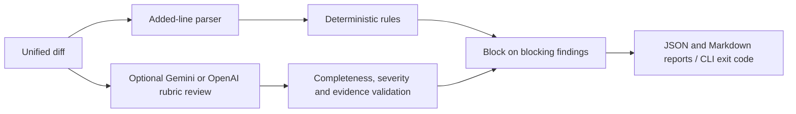

# AI-Generated Code Review Gate

Verified locally with 34 tests and a live Gemini 3.8 Flash review of a synthetic
unsafe change. The gate correctly blocked the change. Synthetic benchmark:
14 positive and 10 clean fixtures passed; these are not production accuracy metrics.

A CI safety net for teams shipping code with AI coding assistants. It reviews only
the lines introduced by a pull request, combines deterministic security/quality
rules with an optional rubric-based LLM review, and blocks merges when concrete
high-severity findings are present.

## What it checks

- **Blocking:** hardcoded secrets, SQL injection patterns, dynamic code execution,
  disabled TLS verification, security problems identified by the rubric, and
  contract-breaking changes.
- **Advisory:** swallowed or overly broad exceptions, debug statements, missing
  tests, error-handling gaps, and maintainability concerns.
- **Calibration:** deterministic findings are authoritative. The LLM must cite
  diff evidence and cannot override a static finding. Advisory comments do not
  fail CI.

## Quick start

```bash
python -m pip install -e .
git diff main...HEAD > change.diff
ai-review-gate review --diff change.diff
```

The command writes `review-report.json`, prints a Markdown report, and exits:

- `0` when no blocking findings exist
- `1` when at least one blocking finding exists
- `2` when the tool itself cannot complete

Enable the optional LLM reviewer:

```bash
export OPENAI_API_KEY="..."
ai-review-gate review --diff change.diff --llm --rubric rubric.json
```

The default CI workflow deliberately runs deterministic checks without an API
dependency. Add `--llm` to its review command after configuring the
`OPENAI_API_KEY` repository secret.

## Benchmark

The labeled benchmark contains 24 intentionally vulnerable and clean changes:

```bash
ai-review-gate benchmark --cases benchmark/cases.json --output benchmark-results.json
```

The command fails unless detection is at least 90% and false positives are below
10%. Add cases to `benchmark/cases.json` as rules evolve. Each case declares the
rule or rules expected to fire; clean cases use an empty list.

## Architecture



1. The diff parser isolates added lines and preserves new-file line numbers.
2. Static rules produce evidence-backed findings with stable IDs.
3. The optional LLM evaluates the written rubric with structured JSON output.
4. The policy engine blocks only on `blocking` findings.
5. JSON and Markdown reports support CI, artifacts, and human review.

## Development

Python 3.11+ is required. On Windows create a virtual environment with
`python -m venv .venv`, then use `.venv\Scripts\python.exe` for Python commands.
The CLI is the user interface; no backend server is needed for this CI tool.
Set `OPENAI_API_KEY` in the shell for live review; `.env.example` is a reference
and is not automatically loaded. Select a model your account can access with
`--model`. The diff is sent to the selected provider only when `--llm` is explicitly requested.

Run `python -m pytest -q` for unit tests, mocked provider integration, and real
CLI subprocess checks of clean and blocking changes. The benchmark contains
24 synthetic fixtures, not a representative production or held-out evaluation.
Its rates must not be presented as real-world model accuracy.

Model reviews reject incomplete rubric coverage, duplicate checks, changed
severity, ungrounded evidence and diffs above 100,000 characters. Rejected
reviews exit with an error instead of reporting a passing gate. Evidence
validation verifies source location, not the semantic correctness of a finding.
Static rules are heuristic and can miss vulnerabilities. CI workflow execution
and actual branch-protection enforcement require separate GitHub verification.

```bash
python -m pip install -e ".[dev]"
pytest
```

This is intentionally a focused MVP. Good next extensions are language-aware AST
rules, SARIF output and GitHub annotations, changed-test correlation, suppression
files with expiry, and a larger benchmark split into calibration and holdout sets.


## Gemini review

Set `GEMINI_API_KEY` in your shell, then run:

```bash
python -m review_gate.cli review --diff change.diff --llm --provider gemini --model gemini-3.8-flash
```

Gemini uses the Google generateContent REST API with JSON Schema output and the
same local evidence, coverage and severity validation as OpenAI. Missing keys,
HTTP failures, truncated responses and invalid reviews fail with exit code 2.
The key is sent in a header, never in the URL or reports. Model availability and
quota depend on your Google project; override `--model` when needed.

Provider API reference: https://ai.google.dev/api/generate-content

## Evaluation and reproducible demo

Run `python scripts/demo.py` to observe and assert a blocked unsafe change followed
by a passing clean change. See [demo instructions](docs/DEMO.md).

Run `python scripts/evaluate.py` for the frozen real-PR pilot. Dataset provenance,
agent-reviewed label limitations, results, latency and cost methodology are in
[evaluation/README.md](evaluation/README.md). Four non-blocking real cases cannot
establish recall; absent denominators are reported as null.

The review workflow runs the trusted base revision against PR diff data, with
read-only permissions and no model secrets. This avoids executing a modified
checker from the proposed branch. Required checks must be configured on GitHub;
workflow files alone do not enforce merge protection. Administrators able to
change protection/workflow settings remain outside this threat model.

Detailed measured results and limitations: [verification report](docs/VERIFICATION.md).
